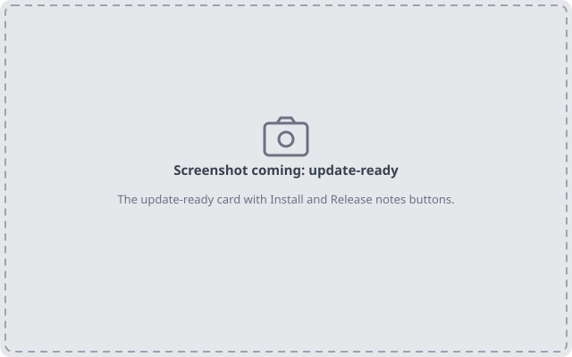

# Update the robot

## The default

The host checks for a new version. It does not install anything. You decide when to install.

The check is one small request to your chosen update source. It sends only the firmware version.

## Settings

| Key | Choices | Default |
|---|---|---|
| `update_channel` | stable, beta, pinned | stable |
| `update_source` | the release manifest, your own server or folder, off | the release manifest |
| `update_check` | never, daily, weekly, manual | weekly |
| `update_install` | ask, auto, auto within a window | ask |

The same keys appear in `robot.toml`, in the web page and on the robot.

## Install an update

1. The robot or the web page tells you a version is ready.
2. Read the release notes, then press Install.
3. The robot downloads the image and checks its signature. An image with a bad signature is refused.
4. It restarts. If it does not pass its health check in 60 seconds, it rolls back to the old version by itself.

## Your own images

Build your own image with `stackchan firmware build` and sign it with your key. Developers: see `docs/dev/build-from-source.md`.
The flasher accepts the official image or a local file. `stackchan firmware verify` compares a downloaded image with a local build.

## If an update fails

See [Troubleshooting](troubleshooting.md).

## Still need help?

Run `stackchan check`, then read [Troubleshooting](troubleshooting.md). If that does not fix it, open an issue on the Issues tab and tell us what you saw.
