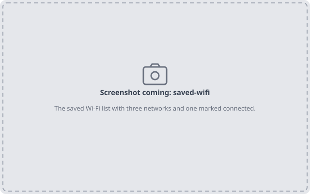

# Take the robot on the go with Tailscale

The robot can join your Tailscale network. Then it reaches your host, or your MaiPai Home hub, from any Wi-Fi: your living room, a friend's house, a hotel.
The link is encrypted end to end by Tailscale, and nothing is opened on your router.

## Why use it

- **Bring the robot anywhere.** Plug it in on any Wi-Fi with internet. It finds your host through your tailnet, so you carry no travel router and no phone app.
- **An encrypted link.** On your home network the link between the robot and the host is plain. Over Tailscale it is encrypted.
- **Still private.** Tailscale connects your own devices to each other. Your voice, snapshots and models stay on your machines.

## Set it up

1. Install Tailscale on the computer that runs the host, and sign in.
2. In the Tailscale admin page, create a reusable auth key for the robot.
3. Open the web settings page, choose **Network**, and paste the key. The robot joins your tailnet and shows its address.

   

4. Run `stackchan check`. It tests the route from the robot to the host over Tailscale and says what is wrong if it fails. You'll know it worked when the route line says ok.

The robot tries your home Wi-Fi first. Set `prefer_tailnet` to a number of minutes if you want it to try Tailscale first for that long.

## Take it on the go with your phone's hotspot

You don't need a travel router or a phone app. The robot joins the hotspot like any Wi-Fi, then reaches your host through Tailscale.

1. Save your phone's hotspot once, while you are at home (see below).
2. Turn on the hotspot when you are out. Keep the phone close to the robot.
3. Power the robot on. You'll know it worked when the face shows that it is connected and it answers a question.

A hotspot uses your phone's data plan. A short chat uses little, but a long session with the camera uses more.

## Saved Wi-Fi networks

The robot remembers several networks, such as home, a friend's house and a hotspot. At a new place it picks the strongest saved network.
Add one from the robot's setup page or the web settings page. Remove any time. Passwords stay on the robot.

## When something fails

| What you see | What went wrong | What to do |
|---|---|---|
| The status says "tailnet: offline" | The robot has no internet on this Wi-Fi, or the key expired. | Check the Wi-Fi, then paste a new key on the Network page. |
| The robot joins but cannot find the host | The host computer is asleep or signed out of Tailscale. | Wake the host and sign in to Tailscale. |
| Replies are slower away from home | The link goes through a relay, not straight to your host. | Wait a minute for a direct route. It usually improves on its own. |

## Using MaiPai Home

The same setup reaches a MaiPai Home hub on your tailnet. See [With MaiPai Home](with-maipai-home.md).

## Still need help?

Run `stackchan check`, then read [Troubleshooting](troubleshooting.md). If that does not fix it, open an issue on the Issues tab and tell us what you saw.
