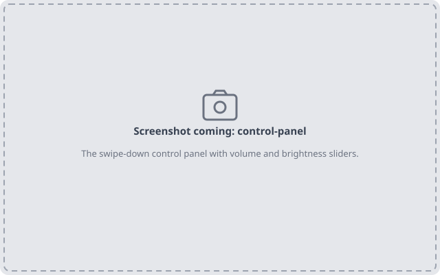
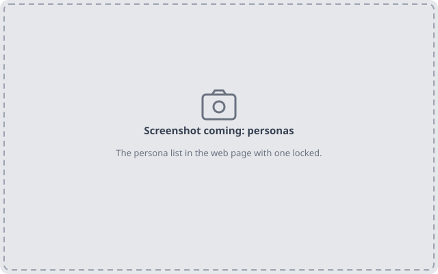

# Talk to the robot

## Talk to the robot

1. Say the wake word. The face perks up and a short tone plays.
2. Ask your question. Dots show while it thinks.
3. It answers out loud. The mouth moves as it speaks.

After an answer the robot keeps listening for a few seconds. You can ask a follow-up without the wake word.
You can also interrupt: speak while it talks and it stops and listens.

## Voice commands

These work in any sentence that starts with the wake word.

| Say | What happens |
|---|---|
| "stop" | It stops talking and any alarm. |
| "mute" | Powers the microphone down. The wake word is off too, so unmute by tapping the mouth or in the web app. See [Mute, camera off and full quiet](mute-and-camera-off.md). |
| "quiet" | Slow, gentle moves and a low voice. |
| "don't move" | The servos hold still. |
| "volume up", "volume 40" | Changes the volume. |
| "brightness down" | Changes the screen brightness. |
| "sleep" | The robot turns away and the screen goes dark. |
| "what time is it" | It speaks the time. |
| "night mode" | Turns night mode on or off. |

## Say "stop" while it talks

The robot hears "stop" even while it is speaking. Say "StackChan, stop", and it goes quiet at once, with no model involved.

## Say "brighter" or "dimmer"

Say "set brightness to 50 percent", "brighter", "dimmer", or "it's too bright". Swipe up on the screen for a control panel with volume, brightness and your saved Wi-Fi. Swipe left or right to change the volume. Swipe down to stop.

## Sounds

The robot uses one family of soft bell sounds. A rising bell means good news, and a falling bell means bad news. At night they are quieter.
Short replies such as "I cannot reach my model right now" are stored on the robot, so it still answers when the host is off.

## Personas

A persona sets the name, the voice and the way the robot talks. Pick one in the web page or set `persona` in `robot.toml`.
Lock a persona with `persona_lock = true` so a spoken request cannot change it. A family-friendly persona is included.
It is a prompt, not a guarantee. The model you connect decides what is said.

## Actions through the model

The robot can do things when you ask in plain words: set a timer, change the volume, show a face. The model chooses the action.
If the model cannot call actions, the voice commands above still work.

## Offline phrases

Short replies such as "I cannot reach my model right now" can play in your own voice, so the robot still talks when the model is down.
Record them once from the web page.

## Your own models

Set `llm_url`, `stt_url` and `tts_url` in `robot.toml`. Leave the speech addresses blank to use the built-in engines.
Run `stackchan check` after any change.

## Lights and sounds

| What you see | What you hear | When |
|---|---|---|
|  Blue ring, steady |  A short rising pop | You said the wake word or tapped, and it is your turn to talk |
|  Green ring, steady | Nothing | Your voice is being sent to your host or hub. It stays on the whole time and never dims |
| No ring, thinking dots on the face | A quiet tone. Change it with `thinking_cue` | The robot is working on the reply |
| No ring, mood face and moving mouth | Its voice | The robot is speaking |
|  Amber ring, one short pulse every 10 seconds |  Two falling notes, once | The robot cannot reach your host. The screen says "Offline" |

See [Lights and sounds](lights-and-sounds.md) for every light and tone.

## Still need help?

Run `stackchan check`, then read [Troubleshooting](troubleshooting.md). If that does not fix it, open an issue on the Issues tab and tell us what you saw.
