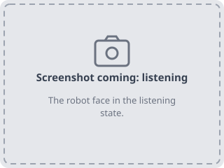

# Talk to the robot

## The basics

1. Say the wake word. The face perks up and a short tone plays.
2. Ask your question. Dots show while it thinks.
3. It answers out loud. The mouth moves as it speaks.

After an answer the robot keeps listening for a few seconds. You can ask a follow-up without the wake word.
While the robot talks, say "stop" to quiet it (see below), or tap it. Interrupting with other words is not built yet. Planned

The light bars glow blue  when it is your turn to talk, with a short rising pop. They glow green  the whole time your voice is being sent to your host or hub. [All lights and sounds](lights-and-sounds.md).

*The robot face in the listening state. A placeholder drawing, not a real screenshot.*

## The wake word

The default wake word is "Hi, Stack Chan". Other ready-made words and a phrase you make up are Planned. Offline voice commands, which need no host, are planned too. The wake word, the English stop word and the audio front end come from Espressif's speech library, which the build downloads under its own license.

## Voice commands

These work in any sentence that starts with the wake word.

| Say | What happens |
|---|---|
| "stop" | It stops talking and any alarm. |
| "mute" | Powers the microphone down. The wake word is off too, so unmute by tapping the mouth or in the settings page on your host. See [Mute, camera off and full quiet](mute-and-camera-off.md). |
| "quiet" | Slow, gentle moves and a low voice. |
| "don't move" | The servos hold still. |
| "volume up", "volume 40" | Changes the volume. |
| "brightness down" | Changes the screen brightness. |
| "sleep" | The robot turns away and the screen goes dark. |
| "what time is it" | It speaks the time. |
| "night mode" | Turns night mode on or off. |

## Say "stop" while it talks

The robot hears "stop" even while it is speaking. Say "StackChan, stop", and it goes quiet at once, with no model involved.

## Say "brighter" or "dimmer"

Say "set brightness to 50 percent", "brighter", "dimmer", or "it's too bright". Swipe up from the bottom edge of the screen for the control sheet with volume, brightness, mute, quiet and more. A swipe that starts at the very side edge of the screen changes the volume. Swipe down to stop. Swipe left or right on the face to move through your [swipe pages](swipe-pages.md).

*The swipe-up control panel with volume and brightness sliders. A placeholder drawing, not a real screenshot.*

## Sounds

The robot uses one family of soft bell sounds. A rising bell means good news, and a falling bell means bad news. At night they are quieter.

## Persona

A persona is a short text that tells the model how to behave, such as its name and how it talks. Type it into the settings page on your host, or set `persona` in `robot.toml`.
It is a prompt, not a guarantee. The model you connect decides what is said.

## Actions through the model

The robot can do things when you ask in plain words: set a timer, change the volume, show a face. The model chooses the action.
If the model cannot call actions, the voice commands above still work.

## Offline phrases

When the robot cannot reach your host or hub, it plays a short spoken line instead of staying silent. Lines are stored on the robot for cases such as no Wi-Fi, still connecting, no host and "I'm back". They use the default synthetic voice, not a recording of a person. Low battery, the wake cue and a finished timer keep their tones.

## Speech speed and pitch

Slow the voice down or speed it up, and raise or lower its pitch, in the settings page on your host.

| Key | Range | Default |
|---|---|---|
| `speech_speed` | 0.75 to 1.5 | 1 |
| `speech_pitch` | -12 to 12 semitones | 0 |

Speed changes how fast it talks without changing the pitch. Each robot keeps its own values.

## Your own models

Set `url`, `stt_url` and `tts_url` under `[llm]` in `robot.toml`. Leave a speech address blank to use the built-in engine, which needs its model folder named in the same section (`stt_model_dir`, `tts_model`, `tts_tokens`, `tts_data_dir`).
Run `stackchan check` after any change.

## Still need help?

Run `stackchan check`, then read [Troubleshooting](troubleshooting.md). If that does not fix it, open an issue on the Issues tab and tell us what you saw.
