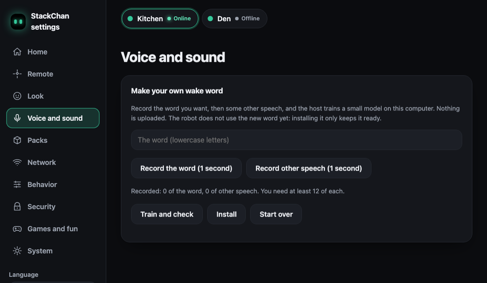

# Make your own wake word (optional)

Off by default. You record a word, the host trains a small model on your computer, and you check how well it works. Nothing is uploaded.

## Turn it on
In `robot.toml`, set `enabled = true` under `[packages.wake_word_maker]`. Restart the host. Open the settings page **on the host computer** and go to Voice and sound.

## Make a word
1. Type your word in lowercase letters, like `pippa`.
2. Press **Record the word** and say it. Do this at least 12 times, in different tones.
3. Press **Record other speech** and say other things. Do this at least 12 times.
4. Press **Train and check**. It takes about a minute.
5. Read the numbers. If they look good, press **Install**.

## What is not done yet
The robot does not use your new word yet. Installing keeps the model ready on the host. The robot keeps listening for its built-in wake word.

Recordings and the model stay in a folder next to the pairing file. Press **Start over** to delete them.
