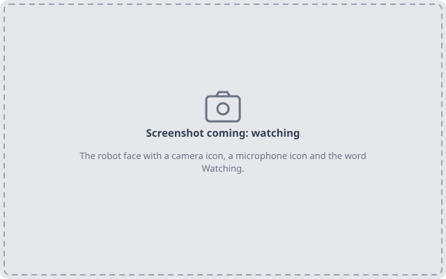
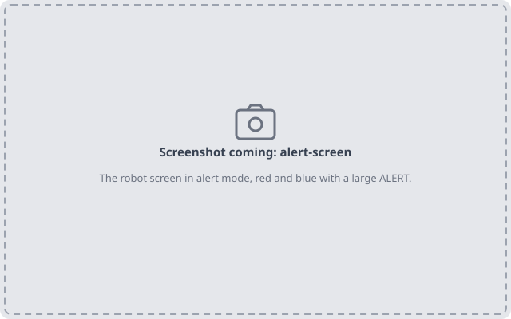

# Watch your room and get alerts

Planned Watching is planned to run on your own host, opt-in, off by default, with a cue that cannot be hidden. Frames and audio stay on your host. Alerts shared across the household, and storage across rooms, need Needs MaiPai Home.

Turn the robot into a watch post. It notices motion and loud sounds, tells you right away, and, if you want, flashes red and blue and sounds a siren.
It runs with MaiPai Home, which handles the alerts, the recipients and what the robot saw.

## Arm it

Say "arm watch", or press **Watch** in the web app. The robot counts down for 30 seconds so you can leave the room, then it starts watching.
To stop, say "disarm", press **Watch** again, or tap the robot's face.

While the robot is watching, the screen always shows a camera icon and the word **Watching**, and a microphone icon if it is listening for sounds. A small dot beside the camera icon lights for one second each time it takes a snapshot to compare. The screen never goes fully dark while it is armed. You cannot turn those cues off.

The light bars stay off at night. By day they can show a dim, steady amber while armed, and you can turn that off in the settings. Pink shows only when the robot takes a picture for an alert or because you asked, and during live view.
Mute and camera off still work: if you turn the camera off, motion watching stops, and if you mute the robot, sound watching stops.

## What it notices

| It notices | How | Needs |
|---|---|---|
| **Motion** | MaiPai Home compares snapshots from the camera and sees something move | The camera on |
| **A loud sound** | The robot measures the loudness of the room. Nothing is recorded or sent unless an alert fires | Sound watching on |
| **The robot being moved or lifted** | Its motion sensor feels it | Nothing extra |
| **A person** | MaiPai Home tells a person from a pet or a curtain, and can say who it is | MaiPai Home |

You set how sensitive each one is, and you can draw an area on the picture to ignore, such as a window with trees outside.

## What happens when it triggers

You pick one of three responses for each watch:

1. **Quiet alert.** The robot tells you and saves a snapshot. It makes no noise.
2. **Warning.** It says "You are being recorded. Please leave", flashes its lights and shows an alert on its screen. The robot records nothing by default, so change the words if that is not true for you.
3. **Alarm.** Everything in the warning, plus a loud siren.

In a warning or an alarm, the light bars swap between red and blue, twice a second, the screen flashes the same red and blue and shows a big **ALERT**, and the siren, if you chose it, rises and falls.
We keep the swap slow, under three flashes a second, so it is safer for people who are sensitive to flashing lights. It stops by itself after one minute, or when you disarm it.

Red and blue are used only in alert mode, so you never see them for anything else.

## Where alerts go

MaiPai Home sends the alert to the people you choose, with the snapshot, what it noticed and the time. It can say what it saw in words ("a person at the door"), name who it saw, and follow your quiet hours and who gets which alert.
The robot also sends the alert to the local API and the event stream, so your own tools can react. The video and the sound stay on your MaiPai Home hub.

## Keep false alarms down

- Start with **Quiet alert** for a day to see what it notices.
- Draw the areas to ignore, and set sensitivity lower in a room with a fan or a window.
- The robot ignores its own voice, its own moves and its own siren.
- A pause of 60 seconds between alerts by default keeps one visitor from sending you ten messages. You can change it.
- The count-down before it arms shows on the screen, so you can see when it starts watching.

## Use it fairly

Tell the people who live there and anyone who visits that the robot can watch and listen. Laws about recording and monitoring differ by place, and some need everyone's consent. Do not point the robot at a neighbor's home or anywhere people expect privacy.
The robot records nothing by default. It is not a replacement for a real alarm or a smoke alarm. This is not legal advice, and you are responsible for following the rules where you live.

## Lights and sounds

While armed, the screen shows the camera icon and **Watching**, and by day the light bars can show a dim, steady amber. In an alert, the light bars swap red and blue and a siren plays. See [Lights and sounds](lights-and-sounds.md).

## Still need help?

Run `stackchan check`, then read [Troubleshooting](troubleshooting.md). If that does not fix it, open an issue on the Issues tab and tell us what you saw.
