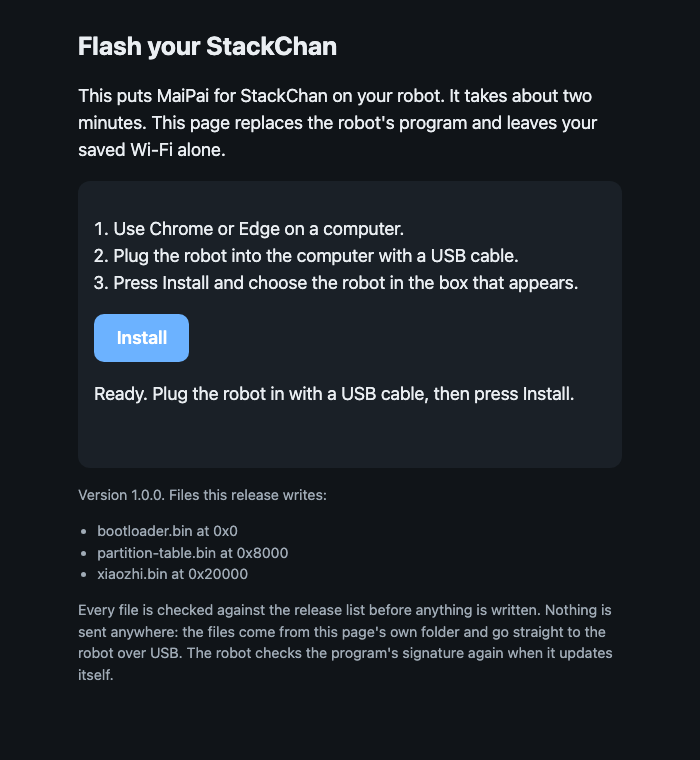

# Flash the robot from a web page

The flasher is a web page. It writes the robot's program over a USB cable.

*The flasher page with an Install button and the list of files.*

## What you need
- A computer with Chrome or Edge.
- A USB cable.
- The flasher page, opened from the release folder.

## Steps
1. Plug the robot into the computer.
2. Press **Install**. The page checks every file first. A changed file stops everything and nothing is written.
3. Choose the robot in the box your browser shows.
4. Wait. Do not unplug the robot. The robot restarts by itself when it is done.

The page leaves your saved Wi-Fi alone. If writing stops, unplug the robot, plug it in again and press Install once more. The robot is not harmed.
