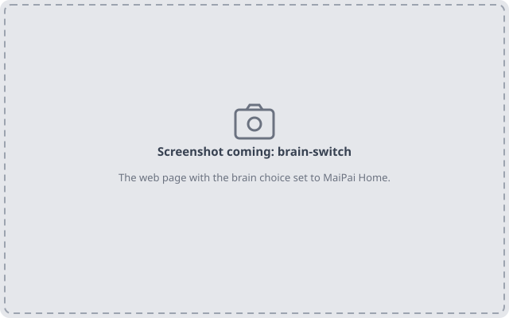

# With MaiPai Home

MaiPai Home is an optional brain. The robot is complete without it. Use it if you already run a MaiPai Home hub and want the robot to share the household's records.

## What it adds

- Memory across days.
- Voices matched to each person.
- Calendars, briefings and household announcements.
- Household rules, including rules for children and teens.
- Song naming and other services that need more than one room.

The standalone robot does none of these by itself.

## Turn it on

1. Open `robot.toml`.
2. Set `brain = "home"` and `home_url` to the hub address, for example `http://192.0.2.20:3000`.
3. Run `stackchan check`.

The robot is not reflashed. Set `brain = "standalone"` to go back. Your timers, faces and settings stay.

## What stays on the robot

Timers, faces, reactions, games and the camera name list work the same either way. A feature that needs a service the brain lacks hides itself.
