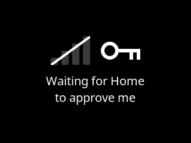

# Use MaiPai Home as the brain

MaiPai Home is an optional brain. The robot is complete without it. Use it if you already run a MaiPai Home hub and want the robot to share the household's records.

## What it adds

These run with MaiPai Home:

- Names for the people the camera sees, and "what is this". [Details](camera.md)
- Household-wide alerts and monitoring across rooms. [Watch](watch-and-alerts.md), [monitor](watch-the-room.md)
- The coding companion, and home tools such as the local API and MQTT. [Coding](coding-companion.md), [tools](home-tools.md)

The camera, remote control and monitoring themselves can run on your own host without Home. See [Find the robot and control it remotely](find-and-remote.md).

And the features across all of MaiPai Home:

- Face and voice recognition, so it knows each person.
- Memories: what matters is remembered from one day to the next.
- "What is this": hold something up to the camera and hear what it is.
- Content filtering and household rules, including rules for children and teens.
- Companions and personalities, each with their own character.
- Custom and cloned voices: a celebrity voice, a family member's voice or a custom one.
- Calendars, briefings and household announcements.
- Song naming and other services that need more than one room.

With your own LLM, the robot does none of these by itself.

## What changes on the robot

When you connect MaiPai Home, Home puts the firmware build on the robot that has the extras. You do not choose a build. The core robot is a small build with no camera streaming, no monitor audio and no remote path, and the Home build adds the parts that Home's features need.

## Turn it on

1. Open `robot.toml`.
2. Set `brain = "home"` and `home_url` to the hub address, for example `http://192.0.2.20:3000`.
3. Run `stackchan check`. You'll know it worked when the check lists Home as the brain and every line says ok.

The robot is not reflashed. Set `brain = "llm"` to go back. Your timers, faces and settings stay.

## What Home needs

MaiPai Home runs on a Mac and lists its memory sizes and disk space on its own install page. Pick the plan that matches your Mac. MaiPai Home adds features, not speed: how fast the robot answers depends on your model and hardware either way. See [Pick hardware and a model](hardware-and-models.md).

## What stays on the robot

Timers, faces and reactions work the same either way. A feature that needs a service the brain lacks hides itself.

## Still need help?

Run `stackchan check`, then read [Troubleshooting](troubleshooting.md). If that does not fix it, open an issue on the Issues tab and tell us what you saw.

First time here? [Choose a brain](choose-a-brain.md) shows the three ways, and the Brain page on the host sets this one up.
